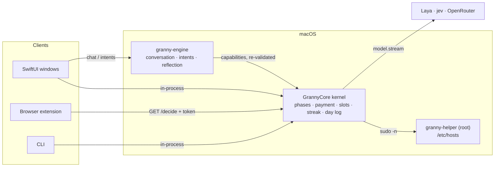
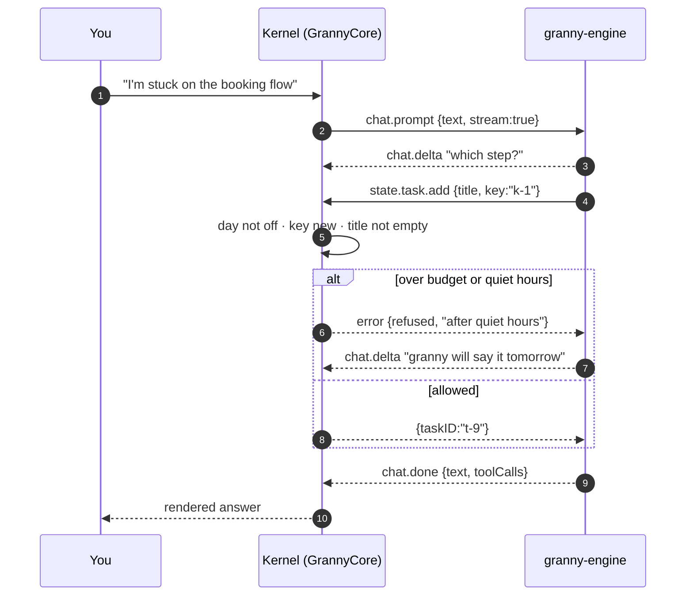
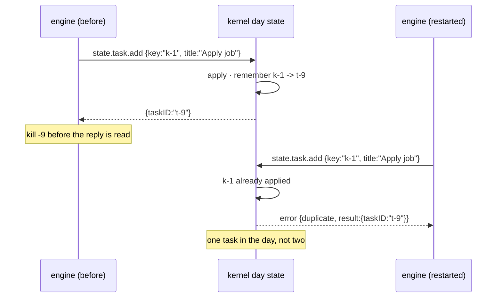
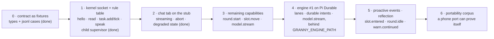

# Engine contract

Status: wire types (`EngineProtocol.swift`), the kernel rule table
(`EngineKernel.swift`: `hello`, `state.read`, `state.task.add`,
`state.task.tick`, `notify.speak`), the local socket + child supervisor
(`EngineServer.swift`, `GRANNY_ENGINE_PATH`, `day.woke`/`round.finished`/`day.rollover`
pushes, `tests/e2e-engine.sh`), and the native chat tab (`ChatView.swift`:
streaming deltas, `chat.abort`, degraded state) are implemented. `round.start`,
`slot.move`, `model.stream` tier wiring, and the Pi Durable runtime remain.
`docs/ARCHITECTURE.md` carries the decision ("The engine, and other platforms"
plus the last two decision-log entries).

Why a contract and not a framework choice: the harness is the only part of
granny that can be wrong, experimental, or dead, and it must never be able to
make granny lenient. Binding the app to a socket makes the harness replaceable
(Pi Durable on macOS or a small server, reachable over the same protocol from a
phone) and keeps the enforcement kernel - the one thing that must stay true -
in Swift.

## The line

| owner | owns | may not |
| --- | --- | --- |
| `GrannyCore` (kernel) | day state, phases, payment, slots, streak, day log, hosts, pomodoro, notifications, model calls (keys, tiers, retries) | assemble a conversation, drive a tool loop |
| `granny-engine` | prompts, the tool loop, conversation, scheduled intents, reflection, lessons | write files, touch hosts, hold keys, open a socket the kernel did not give it, decide a verdict |
| clients | windows, extension, CLI | duplicate kernel rules |

An engine request is a *proposal*. The kernel re-validates and may refuse with
a reason the engine has to live with (the model sees it as a tool error).



The engine has no arrow to `granny-helper`, no arrow to a provider, and no key:
the only way it changes the day is a capability the kernel re-checks, and even
its model calls are a capability (`model.stream`), wired into Pi Durable as a
custom model provider over the socket. The engine process holds no secrets and
needs no outbound network access, which keeps the tier policy and Langfuse
tracing in one place (`GrannyCore`).

## Transport

- macOS: Unix domain socket `<state dir>/engine.sock`, mode 0600, owned by the
  user. The app spawns the engine as a child (`GRANNY_ENGINE_PATH` seam),
  restarts it with backoff, and never blocks on it. Nothing binds TCP. The
  engine has no TTY, no sudo, no TCC grants.
- Phone (iOS / Android): the kernel and OS enforcement (`ManagedSettings` +
  DNS proxy on iOS, `VpnService` on Android) run in-process; the phone reaches
  the Mac's (or a server's) engine over the authenticated relay using the same
  JSON lines. iOS suspends background processes and throttles `BGTaskScheduler`,
  so a proactive durable loop cannot live inside a phone app anyway. When the
  engine is unreachable, the phone still enforces the day and the timetable
  clock, and loses only conversation and free-form nudges.

Framing: newline-delimited JSON objects, one per line, both directions. No
binary, no framing headers - a human can `nc -U` the socket and read it.

## Handshake and versioning

First exchange, both ways:

```json
{"v":1,"method":"hello","params":{
  "role":"engine","impl":"granny-engine/0.1.0","protocol":1,
  "capabilities":["state.read","state.task.add","round.start"]}}
```

The kernel answers with its own `hello` plus `limits` (budget for the day,
quiet hours, whether a model tier is configured). Rules:

- `protocol` must match exactly. A mismatch is fatal and the app says so in
  the menu ("granny's engine speaks a different language") instead of guessing.
- `capabilities` is what the engine *intends* to use; the kernel refuses any
  method not in its own list, whatever the engine claims.
- A method added later bumps `protocol` only when its absence changes
  behaviour; additive methods do not.

## Engine -> kernel: capabilities

Every request carries `id` (engine-local, for correlation) and `key`
(idempotency, see below). `state.read`, `state.task.add`, `state.task.tick` and
`notify.speak` are built; the rest are designed and not built yet.

```json
{"v":1,"id":"e-12","key":"k-8842","method":"state.task.add",
 "params":{"title":"Apply job","detail":"CV done; portal link in mail",
           "source":"chat"}}
```

| method | params | returns / refuses |
| --- | --- | --- |
| `state.read` | `{}` | the day: `phase`, `date`, `dayOff`, `tasks` (`id`, `title`, `done`, `slotID`, `detail`), `slots`, `rounds`, `streak`, `blocksEnforced`, `nudgesRemaining`. Read-only. |
| `device.context` | `{}` | `{frontmostApp, openTabs, calendarEvents}`. Read-only (`replay: "safe"`): native macOS context from `NSWorkspace`, `BrowserJanitor` and `EventKit` without screenshots or a computer-use driver. |
| `state.task.add` | `title`, `detail?`, `slotID?` | `{taskID}`. Refuses: empty title, a day off, a `slotID` that does not exist. Adding an open task to a `rewarded` day relocks the day automatically (`allDone` becomes false). |
| `round.start` | `{}` | `{stage, endsAt}`. Refuses: a round already running, a break in progress. |
| `state.task.tick` | `taskID`, `done` | the new phase. Refuses the unpaid last tick, as the UI does. |
| `slot.move` | `taskID`, `slotID?` | the proposals list. Refuses an unknown slot. |
| `notify.speak` | `text`, `reason` | `{delivered}`. The kernel drops it outside quiet hours or over budget, and says why. |
| `trace.emit` | `span` | `{}`. Best effort; failures never fail the caller. |
| `model.stream` | `messages`, `tools?`, `tier?` | `model.delta` events, then `model.done {text, toolCalls, usage}`. The kernel applies the tier policy (rules → Laya → jev → OpenRouter), the key, the retries and the trace. |

Validation rules that the kernel enforces on *every* capability, in order:
day is not a day off (for mutations), the engine's budget has not been spent,
the value is in range, the idempotency key is new. A refusal returns a reason
the engine can quote to the model; it never returns a partial effect.

One turn, drawn - the refusal path is the interesting half:



## Client -> engine: intents

```json
{"v":1,"id":"c-3","method":"chat.prompt",
 "params":{"text":"I'm stuck on the booking flow","stream":true}}
```

| method | params | notes |
| --- | --- | --- |
| `chat.prompt` | `text`, `stream` | Streams `chat.delta` events, ends with `chat.done {text, toolCalls}`. |
| `chat.abort` | `id` of the run | Forwards `chat.abort` to the engine, releases the waiting prompt stream, and answers `{"aborted": true\|false}` (`true` only when an in-flight run was cancelled). |
| `intent.schedule` | `kind`, `fireAt`, `payload` | Persisted by the engine; the kernel still owns whether it may *speak*. |
| `reflection.run` | `windowDays` | Writes `lessons.jsonl`; never edits the prompt. |
| `lesson.list` / `lesson.accept` | - / `lessonID` | Accepting is what may change a harness file, and it happens as a repo diff, not at runtime. |

Events pushed by the engine: `chat.delta`, `chat.done`, `chat.error`,
`intent.fired`, `engine.status` (ready / degraded / shutting down).

## Kernel -> engine: proactive events and lanes

A proactive coach cannot wait for the grandchild to open a chat window. Two
things wake a background turn in `granny-engine`:

1. **Domain events pushed by the kernel** when the day changes shape:

```json
{"v":1,"event":"slot.entered","params":{"slotID":"morning-deep","taskIDs":["t-1"],"rounds":0}}
```

| event | params | when it fires |
| --- | --- | --- |
| `day.woke` | `date`, `frogs` | First wake after `wakeHour`, alongside the greeting. |
| `slot.entered` | `slotID`, `taskIDs`, `rounds` | The timetable enters a slot that has open tasks pinned to it. |
| `round.idle` | `minutesSinceWake`, `openTasks` | Work mode has been open with `rounds == 0` past the idle threshold. |
| `round.finished` | `rounds`, `stage` | A deep-work round completed and handed over to its break. |
| `warn.continued` | `url`, `title`, `taskIDs` | The user clicked "Continue" on a negotiable `warn` interstitial. |
| `day.rollover` | `date`, `done`, `open`, `rounds` | Midnight rollover wrote the day's line to `state.json.log`. |

2. **Durable timers (`intent.schedule`) and zero-LLM wait probes** persisted in
   Pi Durable's own SQLite journal. During intake or a negotiation ("cho cháu
   20 phút đọc tài liệu này"), the engine schedules a follow-up intent at
   `fireAt` or a lightweight probe (`wait.probe`: check whether `device.context`
   still shows the same tab, whether a git commit landed, or whether `rounds`
   moved). Probes are evaluated deterministically with zero model spend; only
   when the condition fires does the `proactive` lane wake a model turn. Each
   proactive run also carries a one-line `continuitySummary` of what it last
   observed and said, so an unchanged state exits silently instead of repeating
   the same scolding.

**Three lanes in Pi Durable** keep proactive work from stepping on a live
conversation:

- `interactive` - user-initiated `chat.prompt` (intake challenge, negotiation,
  stuck-task coaching). Always takes priority.
- `proactive` - consumes kernel domain events and fired durable intents, calls
  `state.read` (`replay: "safe"`), and decides whether to propose
  `notify.speak` or `slot.move`. The kernel still enforces `nudgesPerDayMax`
  and `quietHours`.
- `reflection` - runs on `day.rollover` or `reflection.run`, reads
  `state.json.log` and appends counted patterns to `lessons.jsonl`.

## Errors

```json
{"v":1,"id":"e-12","error":{"code":"refused","reason":"after quiet hours","retryable":false}}
```

Codes: `refused` (kernel's rules say no), `invalid` (schema), `stale` (the
engine's view of the day is from before a rollover - refetch and retry),
`duplicate` (the key was already applied; the original result is returned),
`unavailable` (the feature is off, e.g. no model configured), `internal`.
Only `stale` and transport failures are retryable.

## Idempotency and replay

An engine restart can repeat an effect, so the kernel is what makes them
safe:

- The engine mints `key` per intended effect, not per attempt. Retrying the
  same effect reuses the key.
- The kernel keeps the last `idempotencyWindow` keys (named constant, default
  500) with their results, persisted in the day state; a repeat returns
  `duplicate` plus the first result.
- Reads are `replay: "safe"`; every mutation is unsafe. An interrupted
  mutation is reported to the engine as `internal`/`retryable: false` and the
  model decides - the same shape Pi documents for tools that are not
  replay-safe.

A crash between the effect and its record, which is the case the key exists
for:



## Budget and quiet hours (kernel-owned)

The engine can ask to speak; the kernel decides. Named in `Config`:

- `nudgesPerDayMax` - hard ceiling across every intent kind.
- `quietStart` / `quietEnd` - the hour range in which `notify.speak` is refused
  with a reason (`nil` falls back to `bedtimeHour` -> `wakeHour`).
- Priority: an intent tied to a task pinned to the current slot outranks a
  free-form nudge; over budget, the free-form one is what gets dropped.

This exists because a broken or over-eager engine must not be able to turn a
strict coach into a nag; the ceiling is not configurable by the engine.

## Storage

- Kernel: `state.json` (unchanged) plus `nudgesSent` and `appliedKeys`.
- Engine: `<state dir>/engine/` (SQLite: transcripts, documents, tasks).
- `state.json.log` stays the fact source for reflection; the engine may write
  `lessons.jsonl` (one counted fact per line) but never edits the log.

## Tests

`tests/e2e-engine.sh`, driven against a stub engine that is a script:

1. Handshake with a wrong `protocol` fails loudly and the app keeps coaching.
2. `state.task.add` twice with the same key adds one task.
3. `state.task.tick` for the last task with `rounds == 0` is refused.
4. `notify.speak` outside quiet hours is refused with a reason; inside budget
   it is delivered.
5. `chat.prompt` streams deltas and ends with `chat.done`; `chat.abort`
   forwards to the engine, releases the stream and answers `{"aborted":true}`
   (`false` when no run is in flight); killing the engine mid-stream leaves the
   kernel's day untouched.
6. `state.read` works with the engine absent (the app's own status path).

Unit tests in `GrannyCoreTests`: the budget, the quiet-hours predicate, the
key window, and each refusal path - they are rule-table logic, not RPC.

## The runtime: Pi Durable, decided

One candidate is chosen: **Pi Durable (`@earendil-works/pi-durable`), running
as the sidecar engine on macOS (and on a server when multi-device sync is on),
with model calls routed through the kernel's `model.stream` capability**.

Rust (`rig-agent`) was considered for in-process iOS builds and lost once
**proactive durability** became a first-class requirement:

| | Pi Durable | Rust + `rig-agent` |
| --- | --- | --- |
| proactive durability | built-in: journaled runs, durable timers across sleep, crash recovery | none - `AgentRun` is a single-turn step machine; we would rewrite Pi Durable in Rust |
| concurrency & isolation | lanes (`interactive`, `proactive`, `reflection`) out of the box | hand-rolled queues, cancellation and SQLite locking |
| phone story | kernel + enforcement run natively on phone; engine is reached over the relay | compiles to a static lib, but iOS `BGTaskScheduler` still blocks proactive background turns |
| model access & keys | custom Pi provider over `model.stream` - kernel keeps keys, tiers and traces | `model.stream` is a kernel capability |
| what ships on macOS | sidecar via `GRANNY_ENGINE_PATH` (Bun single-file compile or local runtime) | a 5-10MB static binary |

Why this flips the decision:

1. **A proactive coach is a scheduler and a journal, not a one-turn loop.**
   Waking up 25 minutes after a negotiated `warn.continued`, surviving Mac
   sleep, resuming an interrupted multi-step check without double-adding a
   task, and keeping background reflection out of an active chat turn are the
   exact problems Pi Durable already solves. Building them around a bare
   `rig-agent` step machine means maintaining a bespoke durable runtime before
   shipping a single proactive nudge.
2. **A phone cannot run a proactive LLM daemon in the background anyway.**
   iOS suspends background tasks and delays `BGTaskScheduler` runs at the
   system's discretion, so an in-process Rust engine on a phone still cannot
   wake on slot boundaries to coach. Keeping the enforcement kernel native on
   each OS (`GrannyCore` + `ManagedSettings`) and running the proactive Pi
   Durable engine on the Mac (or a small relay server) puts each piece where
   the OS actually lets it work.
3. **The kernel still owns the keys and the safety rails.** Pi Durable talks to
   models through a thin custom provider that emits `model.stream` requests on
   `engine.sock`, and every proactive side effect (`notify.speak`,
   `state.task.add`, `slot.move`) passes through the kernel's idempotency
   window, `nudgesPerDayMax` budget and `quietHours` gate. Even a runaway
   proactive loop in the engine cannot spam the user or lift a block.
4. **Why not OpenMausBot (`milind-soni/OpenMausBot`) as the runtime, and what we
   take from it.** OpenMausBot is a full Electron + React + DuckDB multi-bot
   desktop application that wraps external CLI agents (including `pi --mode rpc`
   in its own `server/drivers/pi.ts`) and drives the machine through
   screenshot-based computer use (`@trycua/cua-driver`). Embedding a second
   desktop app beside `Granny.app` would duplicate the UI, the browser janitor
   and OS enforcement. Instead, we keep Pi Durable as the sidecar engine and
   adopt three mechanisms from OpenMausBot's design:
   - **Zero-LLM wait probes (`waits.ts`)**: cheap deterministic checks
     (`device.context`, git/file stamps, open tab URLs) gate the `proactive`
     lane so background watches spend zero tokens until a condition fires.
   - **Continuity carry (`routine-execution.ts`)**: each proactive run stores a
     one-line `continuitySummary` so the next check stays silent when nothing
     changed.
   - **Two-tier device & connected apps**: Tier 1 is native macOS read access
     in `GrannyCore` (`device.context`: frontmost app via `NSWorkspace`, open
     tabs via `BrowserJanitor`, today's calendar/reminders via `EventKit` -
     fast, local, zero screenshots); Tier 2 mounts external work apps (GitHub,
     Google Calendar, Linear, Gmail, Notion) into the Pi Durable engine via
     MCP / Composio so granny can verify deliverables (e.g. a sent application
     or opened PR) and cross-check today's schedule at `day.woke`.

## Steps

Nothing here touches `blocksEnforced`, so every slice below is additive and
can ship alone.



0. Contract as data (done): `EngineProtocol.swift` types and
   `tests/engine/*.jsonl` cases (hello, read, add, refusal, duplicate,
   proactive events) that encode and decode both ways.
1. Kernel server over an `AF_UNIX` socket (done, `EngineKernel.swift` +
   `EngineServer.swift`): handshake, `state.read`, `state.task.add`,
   `state.task.tick`, `notify.speak` (quiet hours, daily ceiling, current-slot
   priority), the idempotency window persisted in the day state, child
   supervision behind `GRANNY_ENGINE_PATH`, and `day.woke` / `round.finished` /
   `day.rollover` pushes. Driven by `tests/e2e-engine.sh` using a `node:net`
   stub.
2. Chat tab on the stub (done, `ChatView.swift` + `RootView.swift`): streaming
   deltas, `chat.abort`, and the degraded state when no socket answers.
   Visible, reviewable, zero model spend.
3. Remaining kernel capabilities: `round.start`, `slot.move`, `trace.emit` and
   `model.stream` wired to `OpenRouterClient`.
4. Engine #1: Pi Durable (`@earendil-works/pi-durable`, pinned), three lanes
   (`interactive`, `proactive`, `reflection`), model calls routed through
   `model.stream`, started by the app behind `GRANNY_ENGINE_PATH`. Crash and
   sleep-resume tests first, features second.
5. Remaining proactive domain events (`slot.entered`, `round.idle`,
   `warn.continued`) and durable scheduled intents; rituals ride on them.
   Reflection writes `lessons.jsonl`; accepting a lesson is a repo diff.
6. `tests/portability/*.json` generated from the Swift rules, so a phone port
   has something to prove itself against.
