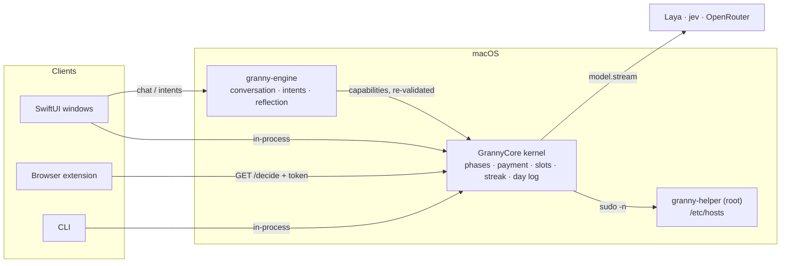
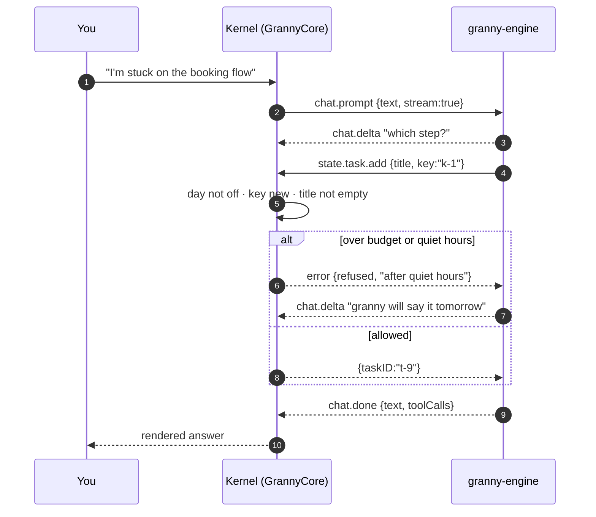
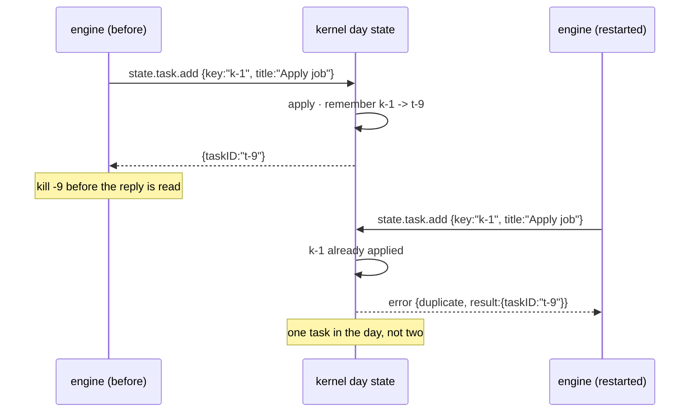
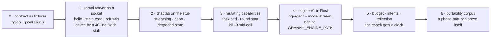

# Engine contract

Status: spec. Nothing below is built; `docs/ARCHITECTURE.md` carries the
decision ("The engine, and other platforms" plus the last two decision-log
entries).

Why a contract and not a framework choice: the harness is the only part of
granny that can be wrong, experimental, or dead, and it must never be able to
make granny lenient. Binding the app to a socket makes the harness replaceable
(a Rust engine on macOS, the same code in-process on iOS) and
keeps the enforcement kernel - the one thing that must stay true - in Swift.

## The line

| owner | owns | may not |
| --- | --- | --- |
| `GrannyCore` (kernel) | day state, phases, payment, slots, streak, day log, hosts, pomodoro, notifications, model calls (keys, tiers, retries) | assemble a conversation, drive a tool loop |
| `granny-engine` | prompts, the tool loop, conversation, scheduled intents, reflection, lessons | write files, touch hosts, hold keys, open a socket the kernel did not give it, decide a verdict |
| clients | windows, extension, CLI | duplicate kernel rules |

An engine request is a *proposal*. The kernel re-validates and may refuse with
a reason the engine has to live with (the model sees it as a tool error).



The engine has no arrow to `granny-helper`, no arrow to a provider, and no key:
the only way it changes the day is a capability the kernel re-checks, and even
its model calls are a capability (`model.stream`). The binary can therefore be
built with no HTTP client, which is what makes the sandbox story trivial and
the same code runnable in-process on a phone.

## Transport

- macOS: Unix domain socket `<state dir>/engine.sock`, mode 0600, owned by the
  user. The app spawns the engine as a child (`GRANNY_ENGINE_PATH` seam),
  restarts it with backoff, and never blocks on it. Nothing binds TCP. The
  engine has no TTY, no sudo, no TCC grants.
- iOS: the same methods in-process (the harness as a library). No socket.
- Remote (later): the same JSON over the app's authenticated loopback/relay
  path, so the phone can ask the Mac. Same protocol, different carrier.

Framing: newline-delimited JSON objects, one per line, both directions. No
binary, no framing headers - a human can `nc -U` the socket and read it.

## Handshake and versioning

First exchange, both ways:

```json
{"v":1,"method":"hello","params":{
  "role":"engine","impl":"granny-engine/0.1.0","protocol":1,
  "capabilities":["state.read","state.task.add","round.start"]}}
```

The kernel answers with its own `hello` plus `limits` (budget for the day,
quiet hours, whether a model tier is configured). Rules:

- `protocol` must match exactly. A mismatch is fatal and the app says so in
  the menu ("granny's engine speaks a different language") instead of guessing.
- `capabilities` is what the engine *intends* to use; the kernel refuses any
  method not in its own list, whatever the engine claims.
- A method added later bumps `protocol` only when its absence changes
  behaviour; additive methods do not.

## Engine -> kernel: capabilities

Every request carries `id` (engine-local, for correlation) and `key`
(idempotency, see below). Phase 1 is the first three; the rest are designed
and not built.

```json
{"v":1,"id":"e-12","key":"k-8842","method":"state.task.add",
 "params":{"title":"Apply job","detail":"CV done; portal link in mail",
           "source":"chat"}}
```

| method | params | returns / refuses |
| --- | --- | --- |
| `state.read` | `{}` | the day: phase, tasks (id, title, done, slotID), slots, rounds, streak, blocksEnforced. Read-only. |
| `state.task.add` | `title`, `detail?`, `slotID?` | `{taskID}`. Refuses: empty title, a day that is rewarded and would be unlocked by it (the kernel relocks), a slotID that does not exist. |
| `round.start` | `{}` | `{stage, endsAt}`. Refuses: a round already running, a break in progress. |
| `state.task.tick` | `taskID`, `done` | the new phase. Refuses the unpaid last tick, as the UI does. |
| `slot.move` | `taskID`, `slotID?` | the proposals list. Refuses an unknown slot. |
| `notify.speak` | `text`, `reason` | `{delivered}`. The kernel drops it outside quiet hours or over budget, and says why. |
| `trace.emit` | `span` | `{}`. Best effort; failures never fail the caller. |
| `model.stream` | `messages`, `tools?`, `tier?` | `model.delta` events, then `model.done {text, toolCalls, usage}`. The kernel applies the tier policy (rules → Laya → jev → OpenRouter), the key, the retries and the trace. |

Validation rules that the kernel enforces on *every* capability, in order:
day is not a day off (for mutations), the engine's budget has not been spent,
the value is in range, the idempotency key is new. A refusal returns a reason
the engine can quote to the model; it never returns a partial effect.

One turn, drawn - the refusal path is the interesting half:



## Client -> engine: intents

```json
{"v":1,"id":"c-3","method":"chat.prompt",
 "params":{"text":"I'm stuck on the booking flow","stream":true}}
```

| method | params | notes |
| --- | --- | --- |
| `chat.prompt` | `text`, `stream` | Streams `chat.delta` events, ends with `chat.done {text, toolCalls}`. |
| `chat.abort` | `id` of the run | Stops the run; the kernel is unaffected. |
| `intent.schedule` | `kind`, `fireAt`, `payload` | Persisted by the engine; the kernel still owns whether it may *speak*. |
| `reflection.run` | `windowDays` | Writes `lessons.jsonl`; never edits the prompt. |
| `lesson.list` / `lesson.accept` | - / `lessonID` | Accepting is what may change a harness file, and it happens as a repo diff, not at runtime. |

Events pushed by the engine: `chat.delta`, `chat.done`, `chat.error`,
`intent.fired`, `engine.status` (ready / degraded / shutting down).

## Errors

```json
{"v":1,"id":"e-12","error":{"code":"refused","reason":"after quiet hours","retryable":false}}
```

Codes: `refused` (kernel's rules say no), `invalid` (schema), `stale` (the
engine's view of the day is from before a rollover - refetch and retry),
`duplicate` (the key was already applied; the original result is returned),
`unavailable` (the feature is off, e.g. no model configured), `internal`.
Only `stale` and transport failures are retryable.

## Idempotency and replay

An engine restart can repeat an effect, so the kernel is what makes them
safe:

- The engine mints `key` per intended effect, not per attempt. Retrying the
  same effect reuses the key.
- The kernel keeps the last `idempotencyWindow` keys (named constant, default
  500) with their results, persisted in the day state; a repeat returns
  `duplicate` plus the first result.
- Reads are `replay: "safe"`; every mutation is unsafe. An interrupted
  mutation is reported to the engine as `internal`/`retryable: false` and the
  model decides - the same shape Pi documents for tools that are not
  replay-safe.

A crash between the effect and its record, which is the case the key exists
for:



## Budget and quiet hours (kernel-owned)

The engine can ask to speak; the kernel decides. Named in `Config`:

- `nudgesPerDayMax` - hard ceiling across every intent kind.
- `quietHours` - a range in which `notify.speak` is refused with a reason.
- Priority: an intent tied to a task pinned to the current slot outranks a
  free-form nudge; over budget, the free-form one is what gets dropped.

This exists because a broken or over-eager engine must not be able to turn a
strict coach into a nag; the ceiling is not configurable by the engine.

## Storage

- Kernel: `state.json` (unchanged) plus a new `applied-keys` section.
- Engine: `<state dir>/engine/` (SQLite: transcripts, documents, tasks).
- `state.json.log` stays the fact source for reflection; the engine may write
  `lessons.jsonl` (one counted fact per line) but never edits the log.

## Tests

`tests/e2e-engine.sh`, driven against a stub engine that is a script:

1. Handshake with a wrong `protocol` fails loudly and the app keeps coaching.
2. `state.task.add` twice with the same key adds one task.
3. `state.task.tick` for the last task with `rounds == 0` is refused.
4. `notify.speak` outside quiet hours is refused with a reason; inside budget
   it is delivered.
5. `chat.prompt` streams deltas and ends with `chat.done`; killing the engine
   mid-stream leaves the kernel's day untouched.
6. `state.read` works with the engine absent (the app's own status path).

Unit tests in `GrannyCoreTests`: the budget, the quiet-hours predicate, the
key window, and each refusal path - they are rule-table logic, not RPC.

## The runtime: Rust, decided

One candidate remains: **a Rust engine, with `rig_agent`'s run protocol and no
JavaScript runtime**. Pi Durable was the first candidate and lost on one thing
only - the platform floor:

| | Pi Durable | Rust + `rig-agent` |
| --- | --- | --- |
| runs on a phone (in-process) | no - Node cannot be embedded in an iOS app | yes - a static library |
| what ships in the `.app` | a Bun runtime (~80MB), vendored `node_modules` | a 5-10MB static binary, no GC |
| durability fit | the whole substrate, with an experimental API | a sans-IO step machine; we keep our own entries |
| model access | the engine holds keys and calls out | `model.stream` is a kernel capability |

An engine that cannot run on a phone cannot be granny's only engine, and the
plan already says the engine is a *library* on iOS. That sentence picks Rust by
itself; everything else is a bonus.

**What we depend on**: `rig-agent` only, default features off, exact version
pinned - `AgentRun` is a serializable step machine that returns
`CallModel`/`CallTools`/`Done` and performs no IO, so *the kernel is the
driver*: it executes the model call and answers with the response. That is what
keeps the engine network-free and the tier policy in one place. Rig's own
session format is not used for storage (`rig-session/2`, and its envelope is
not compatible across versions); our SQLite holds our entries, and a run's
state lives for one turn. A thin `ModelStep` trait wraps the crate so a
hand-written loop can replace it in a day if the pin becomes a problem.

**What we take from Pi Durable - the semantics, not the code**: an effect is
recorded before it happens and its result carries the id it promised; only
reads are `replay: "safe"`; a run is accepted before it executes; parallel work
lives in lanes. Those four are already in this contract's idempotency section,
and Pi's documented failure modes stay the checklist we test against.

Revisit only if the engine ever moves to a server (multi-user, multi-device);
then Pi Durable becomes a candidate again for that server-side piece.

## Steps

Nothing here touches `blocksEnforced`, so every slice below is additive and
can ship alone.



0. Contract as data: `EngineProtocol.swift` types and
   `tests/engine/*.jsonl` cases (hello, read, add, refusal, duplicate) that
   encode and decode both ways. No process, no socket - just the shape, and a
   target for any engine in any language.
1. Kernel server over an `AF_UNIX` socket (`EngineServer.swift`): handshake,
   `state.read`, every refusal path, the idempotency window persisted in the
   day state. `tests/e2e-engine.sh` drives it with a 40-line Node stub using
   nothing but `node:net` - if the contract needs a Swift-shaped client, it
   is the wrong contract.
2. Chat tab on the stub: streaming deltas, abort, and the degraded state when
   no socket answers. Visible, reviewable, zero model spend.
3. Mutating capabilities (`state.task.add`, `round.start`) and the crash test
   that gives them meaning: `kill -9` the stub between the effect and the
   reply, restart it, and the day holds one task.
4. Engine #1: Rust, `rig-agent` pinned, model calls through `model.stream`,
   started by the app behind `GRANNY_ENGINE_PATH`. Crash test first, features
   second.
5. Budget, quiet hours and the intent table in the kernel; rituals ride on
   them. Reflection writes `lessons.jsonl`; accepting a lesson is a repo diff.
6. `tests/portability/*.json` generated from the Swift rules, so a phone port
   has something to prove itself against.
